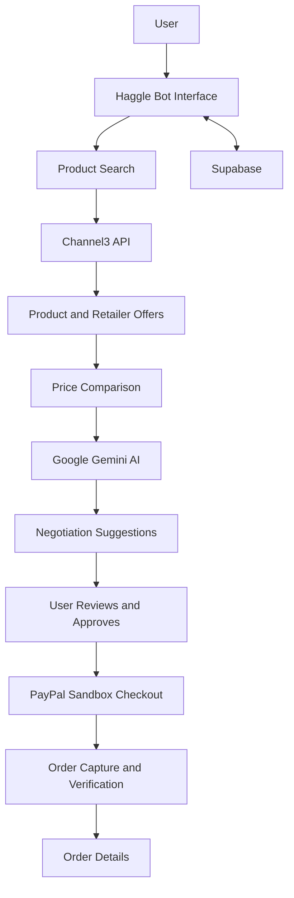

# 🤖 Haggle Bot – AI-Powered Shopping Negotiation Assistant

**Shop smarter. Negotiate better. Save more.**

Haggle Bot is an AI-powered shopping assistant designed to make online shopping smarter, easier, and more budget-friendly. It combines product discovery, retailer price comparison, AI-powered negotiation assistance, and PayPal checkout into a single platform.

Instead of manually visiting multiple shopping websites, users can discover products, compare available offers, set their budgets, and receive intelligent negotiation suggestions through an AI assistant.

---

## 🚀 Project Overview

Finding the best deal online can be time-consuming. Customers often have to visit multiple websites, compare prices, and decide whether a product fits their budget.

Haggle Bot simplifies this process by bringing multiple shopping features together in one place.

The application uses Channel3 for product discovery, Google Gemini for AI-powered negotiation suggestions, Supabase for data management, and PayPal Sandbox for payment testing.

## ✨ Key Features

- 🔍 **AI-Powered Product Discovery:** Search for products and retrieve available retailer offers.
- 💰 **Price Comparison:** Compare product prices across different retailers.
- 🎯 **Budget-Based Shopping:** Set a budget and explore suitable offers.
- 🤖 **AI Negotiation Assistant:** Receive intelligent negotiation suggestions powered by Google Gemini.
- 💳 **PayPal Checkout:** Proceed through a PayPal Sandbox payment workflow.
- 📦 **Order Management:** View order details and payment status.
- 🔐 **User Authentication:** Manage user accounts through Supabase.

## 🛠️ Technology Stack

| Technology | Purpose |
|---|---|
| Lovable | AI-assisted application development |
| Channel3 API | Product discovery and retailer offer information |
| Google Gemini API | AI-powered negotiation suggestions |
| PayPal Developer Platform | Sandbox checkout and payment processing |
| Supabase | Authentication and database management |
| React | Frontend user interface |
| TypeScript | Application development |
| Tailwind CSS | User interface styling |

## 💳 PayPal Integration

Haggle Bot integrates the **PayPal Developer Platform** using the PayPal Sandbox environment.

The PayPal integration demonstrates how users can proceed from product selection to checkout.

### PayPal tools used

**1. PayPal Sandbox**

Provides a testing environment to simulate payment transactions without using real money.

**2. PayPal Orders API**

Used to create payment orders based on the selected product and its listed price.

**3. PayPal Checkout**

Allows users to review and approve their payment through the PayPal checkout experience.

**4. Order Capture**

After user approval, the application processes the payment capture through its backend and handles the resulting payment status.

### Payment Workflow

1. User selects a product and reviews its price.
2. Haggle Bot creates a PayPal Sandbox order.
3. User proceeds to PayPal checkout.
4. User approves the test payment using a Sandbox buyer account.
5. The backend processes the approved order.
6. The application displays the resulting order and payment information.

**Note:** PayPal Sandbox is used for demonstration and testing. No real money is charged.

## 🧠 AI Integration – Google Gemini

Haggle Bot uses the **Google Gemini API** as its AI-powered negotiation assistant.

Gemini analyzes product information and user-defined budgets to generate useful shopping and negotiation suggestions.

### What Gemini does

- Analyzes the listed product price.
- Considers the user's budget.
- Generates potential negotiation target prices.
- Suggests negotiation strategies.
- Provides conversational shopping assistance.

The AI-generated negotiation prices are suggestions and do not represent confirmed offers or agreements from real retailers.

## 🔎 Channel3 Integration

Haggle Bot uses the **Channel3 API** to retrieve product information and available retailer offers.

Channel3 supports the product discovery and price comparison experience by helping users explore products and compare available prices.

## 🗄️ Database and Authentication – Supabase

Supabase is used to support the application's backend data requirements.

Its functionality includes:

- User authentication.
- User profile management.
- Product and retailer offer data.
- Negotiation-related information.
- Order information and payment status.

## ⚙️ How the Application Works



## 🖥️ Getting Started

### Prerequisites

- Node.js and npm.
- Git.
- A Channel3 API account and API key.
- A Google Gemini API key.
- A Supabase project.
- A PayPal Developer account with Sandbox credentials.

### Installation

**1. Clone the repository**

```bash
git clone https://github.com/YOUR_USERNAME/haggle-bot.git
```

**2. Navigate to the project directory**

```bash
cd haggle-bot
```

**3. Install dependencies**

```bash
npm install
```

**4. Configure environment variables**

Create a `.env` file based on the project's required configuration.

Example placeholder file:

```env
VITE_SUPABASE_URL=your_supabase_url
VITE_SUPABASE_PUBLISHABLE_KEY=your_supabase_publishable_key
VITE_SUPABASE_PROJECT_ID=your_supabase_project_id

CHANNEL3_API_KEY=your_channel3_api_key
GEMINI_API_KEY=your_gemini_api_key

SUPABASE_URL=your_supabase_url
SUPABASE_PUBLISHABLE_KEY=your_supabase_publishable_key
SUPABASE_SERVICE_ROLE_KEY=your_supabase_service_role_key
```

Configure the PayPal and other backend credentials using the secure server-side configuration required by the application.

**Important:** The variables above are examples. Check the actual application code and backend configuration for the exact variable names. Never expose secret keys in frontend code or commit real credentials to GitHub.

**5. Start the development server**

```bash
npm run dev
```

Open the local URL displayed in your terminal to access the application.

*Note: Local development requires the backend services and environment variables used by the project to be configured correctly.*

## 🔒 Security

Security is an important part of Haggle Bot.

- Sensitive API keys should be stored in server-side environment variables.
- Supabase Row Level Security should protect user-specific data.
- Payment capture should be handled and verified by the backend.
- Users should review and approve payments before checkout.
- PayPal Sandbox is used for payment testing.

## 🔮 Future Improvements

We plan to improve Haggle Bot with:

- Real seller negotiation through participating retailer integrations.
- Smarter AI negotiation strategies.
- More retailer and shopping platform integrations.
- Product price tracking and price-drop notifications.
- Personalized product recommendations.
- Mobile application support.
- Production-ready PayPal payment integration.

## 🏆 Hackathon Project

**Project Name:** Haggle Bot  
**Category:** AI-Powered E-commerce  
**Payment Integration:** PayPal Developer Platform – Sandbox  
**AI Integration:** Google Gemini API

Built as part of the PayPal hackathon to explore how AI and digital payment technologies can improve the online shopping experience.

## 📄 License

This project is licensed under the MIT License. See the [LICENSE](LICENSE) file for details.

---

**Haggle Bot – Shop smarter. Negotiate better. Save more.**
